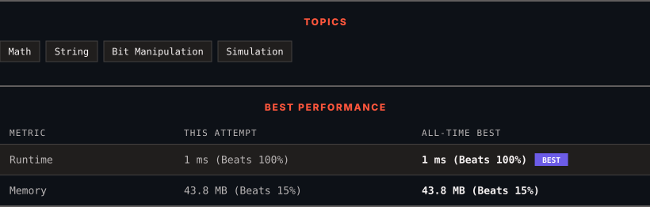

<div align="center">

# 67. Add Binary

      

[](https://leetcode.com/problems/add-binary/)

</div>

---

<div align="center">

<picture>
  <source media="(prefers-color-scheme: dark)" srcset="panel-dark.svg">
  <source media="(prefers-color-scheme: light)" srcset="panel-light.svg">
  
</picture>

</div>

> **New personal best** — Runtime improved on this submission.

### HOW IT WENT

| | |
|:--|:--|
| **Attempts** | first try |
| **Time to solve** | under a minute |
| **Verdicts** | ✅ Accepted |

---

### NOTES

_No notes yet._

---

### SOLUTIONS (1)

| # | File | Language | Date |
|:-:|------|:--------:|:----:|
| 1 | [sol1.java](./sol1.java) | `Java` | 2026-10-11 ← **latest** |

---

### PROBLEM DESCRIPTION

Given two binary strings `a` and `b`, return *their sum as a binary string*.

 

**Example 1:**

```
**Input:** a = "11", b = "1"
**Output:** "100"

```

**Example 2:**

```
**Input:** a = "1010", b = "1011"
**Output:** "10101"

```

 

**Constraints:**

	- `1 <= a.length, b.length <= 10^4`

	- `a` and `b` consist only of `'0'` or `'1'` characters.

	- Each string does not contain leading zeros except for the zero itself.

---

<div align="center">

<sub>Auto-synced by <strong>LeetSync</strong> · Built by <a href="https://deveshsamant.in/">Devesh Samant</a></sub>

</div>
