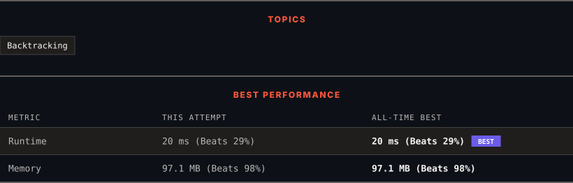

<div align="center">

# 77. Combinations

      

[](https://leetcode.com/problems/combinations/)

</div>

---

<div align="center">

<picture>
  <source media="(prefers-color-scheme: dark)" srcset="panel-dark.svg">
  <source media="(prefers-color-scheme: light)" srcset="panel-light.svg">
  
</picture>

</div>

> **New personal best** — Runtime improved on this submission.

### HOW IT WENT

| | |
|:--|:--|
| **Attempts** | first try |
| **Time to solve** | under a minute |
| **Verdicts** | ✅ Accepted |

---

### NOTES

_No notes yet._

---

### SOLUTIONS (1)

| # | File | Language | Date |
|:-:|------|:--------:|:----:|
| 1 | [sol1.java](./sol1.java) | `Java` | 2026-10-27 ← **latest** |

---

### PROBLEM DESCRIPTION

Given two integers `n` and `k`, return *all possible combinations of* `k` *numbers chosen from the range* `[1, n]`.

You may return the answer in **any order**.

 

**Example 1:**

```

**Input:** n = 4, k = 2
**Output:** [[1,2],[1,3],[1,4],[2,3],[2,4],[3,4]]
**Explanation:** There are 4 choose 2 = 6 total combinations.
Note that combinations are unordered, i.e., [1,2] and [2,1] are considered to be the same combination.

```

**Example 2:**

```

**Input:** n = 1, k = 1
**Output:** [[1]]
**Explanation:** There is 1 choose 1 = 1 total combination.

```

 

**Constraints:**

	- `1 <= n <= 20`

	- `1 <= k <= n`

---

<div align="center">

<sub>Auto-synced by <strong>LeetSync</strong> · Built by <a href="https://deveshsamant.in/">Devesh Samant</a></sub>

</div>
