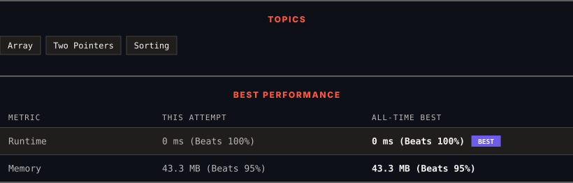

<div align="center">

# 88. Merge Sorted Array

      

[](https://leetcode.com/problems/merge-sorted-array/)

</div>

---

<div align="center">

<picture>
  <source media="(prefers-color-scheme: dark)" srcset="panel-dark.svg">
  <source media="(prefers-color-scheme: light)" srcset="panel-light.svg">
  
</picture>

</div>

> **New personal best** — Runtime improved on this submission.

### HOW IT WENT

| | |
|:--|:--|
| **Attempts** | first try |
| **Time to solve** | 174 h 35 min |
| **Verdicts** | ✅ Accepted |

---

### NOTES

_No notes yet._

---

### SOLUTIONS (1)

| # | File | Language | Date |
|:-:|------|:--------:|:----:|
| 1 | [sol1.java](./sol1.java) | `Java` | 2026-10-25 ← **latest** |

---

### PROBLEM DESCRIPTION

You are given two integer arrays `nums1` and `nums2`, sorted in **non-decreasing order**, and two integers `m` and `n`, representing the number of elements in `nums1` and `nums2` respectively.

**Merge** `nums1` and `nums2` into a single array sorted in **non-decreasing order**.

The final sorted array should not be returned by the function, but instead be *stored inside the array *`nums1`. To accommodate this, `nums1` has a length of `m + n`, where the first `m` elements denote the elements that should be merged, and the last `n` elements are set to `0` and should be ignored. `nums2` has a length of `n`.

 

**Example 1:**

```

**Input:** nums1 = [1,2,3,0,0,0], m = 3, nums2 = [2,5,6], n = 3
**Output:** [1,2,2,3,5,6]
**Explanation:** The arrays we are merging are [1,2,3] and [2,5,6].
The result of the merge is [1,2,2,3,5,6] with the underlined elements coming from nums1.

```

**Example 2:**

```

**Input:** nums1 = [1], m = 1, nums2 = [], n = 0
**Output:** [1]
**Explanation:** The arrays we are merging are [1] and [].
The result of the merge is [1].

```

**Example 3:**

```

**Input:** nums1 = [0], m = 0, nums2 = [1], n = 1
**Output:** [1]
**Explanation:** The arrays we are merging are [] and [1].
The result of the merge is [1].
Note that because m = 0, there are no elements in nums1. The 0 is only there to ensure the merge result can fit in nums1.

```

 

**Constraints:**

	- `nums1.length == m + n`

	- `nums2.length == n`

	- `0 <= m, n <= 200`

	- `1 <= m + n <= 200`

	- `-10^9 <= nums1[i], nums2[j] <= 10^9`

 

**Follow up: **Can you come up with an algorithm that runs in `O(m + n)` time?

---

<div align="center">

<sub>Auto-synced by <strong>LeetSync</strong> · Built by <a href="https://deveshsamant.in/">Devesh Samant</a></sub>

</div>
