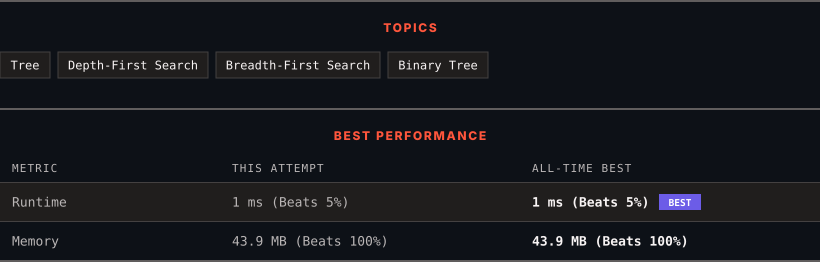

<div align="center">

# 112. Path Sum

      

[](https://leetcode.com/problems/path-sum/)

</div>

---

<div align="center">

<picture>
  <source media="(prefers-color-scheme: dark)" srcset="panel-dark.svg">
  <source media="(prefers-color-scheme: light)" srcset="panel-light.svg">
  
</picture>

</div>

> **New personal best** — Runtime improved on this submission.

### HOW IT WENT

| | |
|:--|:--|
| **Attempts** | first try |
| **Time to solve** | 670 h 42 min |
| **Verdicts** | ✅ Accepted |

---

### NOTES

_No notes yet._

---

### SOLUTIONS (1)

| # | File | Language | Date |
|:-:|------|:--------:|:----:|
| 1 | [sol1.java](./sol1.java) | `Java` | 2026-11-01 ← **latest** |

---

### PROBLEM DESCRIPTION

Given the `root` of a binary tree and an integer `targetSum`, return `true` if the tree has a **root-to-leaf** path such that adding up all the values along the path equals `targetSum`.

A **leaf** is a node with no children.

 

**Example 1:**


```

**Input:** root = [5,4,8,11,null,13,4,7,2,null,null,null,1], targetSum = 22
**Output:** true
**Explanation:** The root-to-leaf path with the target sum is shown.

```

**Example 2:**


```

**Input:** root = [1,2,3], targetSum = 5
**Output:** false
**Explanation:** There are two root-to-leaf paths in the tree:
(1 --> 2): The sum is 3.
(1 --> 3): The sum is 4.
There is no root-to-leaf path with sum = 5.

```

**Example 3:**

```

**Input:** root = [], targetSum = 0
**Output:** false
**Explanation:** Since the tree is empty, there are no root-to-leaf paths.

```

 

**Constraints:**

	- The number of nodes in the tree is in the range `[0, 5000]`.

	- `-1000 <= Node.val <= 1000`

	- `-1000 <= targetSum <= 1000`

---

<div align="center">

<sub>Auto-synced by <strong>LeetSync</strong> · Built by <a href="https://deveshsamant.in/">Devesh Samant</a></sub>

</div>
