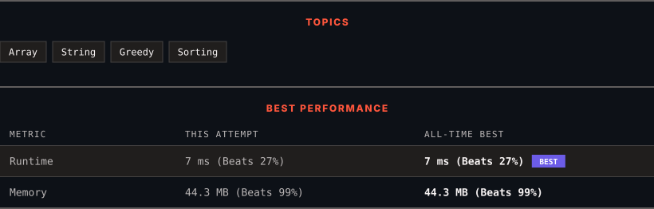

<div align="center">

# 179. Largest Number

      

[](https://leetcode.com/problems/largest-number/)

</div>

---

<div align="center">

<picture>
  <source media="(prefers-color-scheme: dark)" srcset="panel-dark.svg">
  <source media="(prefers-color-scheme: light)" srcset="panel-light.svg">
  
</picture>

</div>

> **New personal best** — Runtime improved on this submission.

### HOW IT WENT

| | |
|:--|:--|
| **Attempts** | first try |
| **Time to solve** | under a minute |
| **Verdicts** | ✅ Accepted |

---

### NOTES

_No notes yet._

---

### SOLUTIONS (1)

| # | File | Language | Date |
|:-:|------|:--------:|:----:|
| 1 | [sol1.java](./sol1.java) | `Java` | 2026-10-20 ← **latest** |

---

### PROBLEM DESCRIPTION

Given a list of non-negative integers `nums`, arrange them such that they form the largest number and return it.

Since the result may be very large, so you need to return a string instead of an integer.

 

**Example 1:**

```

**Input:** nums = [10,2]
**Output:** "210"

```

**Example 2:**

```

**Input:** nums = [3,30,34,5,9]
**Output:** "9534330"

```

 

**Constraints:**

	- `1 <= nums.length <= 100`

	- `0 <= nums[i] <= 10^9`

---

<div align="center">

<sub>Auto-synced by <strong>LeetSync</strong> · Built by <a href="https://deveshsamant.in/">Devesh Samant</a></sub>

</div>
