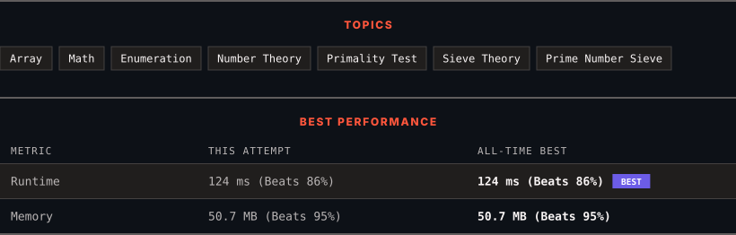

<div align="center">

# 204. Count Primes

      

[](https://leetcode.com/problems/count-primes/)

</div>

---

<div align="center">

<picture>
  <source media="(prefers-color-scheme: dark)" srcset="panel-dark.svg">
  <source media="(prefers-color-scheme: light)" srcset="panel-light.svg">
  
</picture>

</div>

> **New personal best** — Runtime improved on this submission.

### HOW IT WENT

| | |
|:--|:--|
| **Attempts** | first try |
| **Time to solve** | under a minute |
| **Verdicts** | ✅ Accepted |

---

### NOTES

_No notes yet._

---

### SOLUTIONS (1)

| # | File | Language | Date |
|:-:|------|:--------:|:----:|
| 1 | [sol1.java](./sol1.java) | `Java` | 2026-10-24 ← **latest** |

---

### PROBLEM DESCRIPTION

Given an integer `n`, return *the number of prime numbers that are strictly less than* `n`.

 

**Example 1:**

```

**Input:** n = 10
**Output:** 4
**Explanation:** There are 4 prime numbers less than 10, they are 2, 3, 5, 7.

```

**Example 2:**

```

**Input:** n = 0
**Output:** 0

```

**Example 3:**

```

**Input:** n = 1
**Output:** 0

```

 

**Constraints:**

	- `0 <= n <= 5 * 10^6`

---

<div align="center">

<sub>Auto-synced by <strong>LeetSync</strong> · Built by <a href="https://deveshsamant.in/">Devesh Samant</a></sub>

</div>
