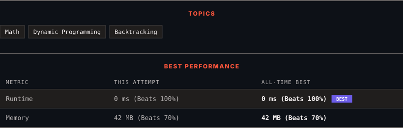

<div align="center">

# 357. Count Numbers with Unique Digits

      

[](https://leetcode.com/problems/count-numbers-with-unique-digits/)

</div>

---

<div align="center">

<picture>
  <source media="(prefers-color-scheme: dark)" srcset="panel-dark.svg">
  <source media="(prefers-color-scheme: light)" srcset="panel-light.svg">
  
</picture>

</div>

> **New personal best** — Runtime improved on this submission.

### HOW IT WENT

| | |
|:--|:--|
| **Attempts** | first try |
| **Time to solve** | under a minute |
| **Verdicts** | ✅ Accepted |

---

### NOTES

_No notes yet._

---

### SOLUTIONS (1)

| # | File | Language | Date |
|:-:|------|:--------:|:----:|
| 1 | [sol1.java](./sol1.java) | `Java` | 2026-10-12 ← **latest** |

---

### PROBLEM DESCRIPTION

Given an integer `n`, return the count of all numbers with unique digits, `x`, where `0 <= x < 10^n`.

 

**Example 1:**

```

**Input:** n = 2
**Output:** 91
**Explanation:** The answer should be the total numbers in the range of 0 ≤ x < 100, excluding 11,22,33,44,55,66,77,88,99

```

**Example 2:**

```

**Input:** n = 0
**Output:** 1

```

 

**Constraints:**

	- `0 <= n <= 8`

---

<div align="center">

<sub>Auto-synced by <strong>LeetSync</strong> · Built by <a href="https://deveshsamant.in/">Devesh Samant</a></sub>

</div>
