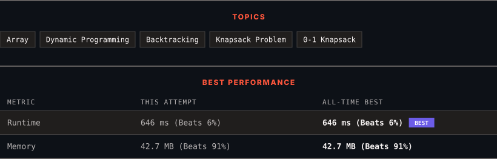

<div align="center">

# 494. Target Sum

      

[](https://leetcode.com/problems/target-sum/)

</div>

---

<div align="center">

<picture>
  <source media="(prefers-color-scheme: dark)" srcset="panel-dark.svg">
  <source media="(prefers-color-scheme: light)" srcset="panel-light.svg">
  
</picture>

</div>

> **New personal best** — Runtime improved on this submission.

### HOW IT WENT

| | |
|:--|:--|
| **Attempts** | first try |
| **Time to solve** | under a minute |
| **Verdicts** | ✅ Accepted |

---

### NOTES

_No notes yet._

---

### SOLUTIONS (1)

| # | File | Language | Date |
|:-:|------|:--------:|:----:|
| 1 | [sol1.java](./sol1.java) | `Java` | 2026-10-26 ← **latest** |

---

### PROBLEM DESCRIPTION

You are given an integer array `nums` and an integer `target`.

You want to build an **expression** out of nums by adding one of the symbols `'+'` and `'-'` before each integer in nums and then concatenate all the integers.

	- For example, if `nums = [2, 1]`, you can add a `'+'` before `2` and a `'-'` before `1` and concatenate them to build the expression `"+2-1"`.

Return the number of different **expressions** that you can build, which evaluates to `target`.

 

**Example 1:**

```

**Input:** nums = [1,1,1,1,1], target = 3
**Output:** 5
**Explanation:** There are 5 ways to assign symbols to make the sum of nums be target 3.
-1 + 1 + 1 + 1 + 1 = 3
+1 - 1 + 1 + 1 + 1 = 3
+1 + 1 - 1 + 1 + 1 = 3
+1 + 1 + 1 - 1 + 1 = 3
+1 + 1 + 1 + 1 - 1 = 3

```

**Example 2:**

```

**Input:** nums = [1], target = 1
**Output:** 1

```

 

**Constraints:**

	- `1 <= nums.length <= 20`

	- `0 <= nums[i] <= 1000`

	- `0 <= sum(nums[i]) <= 1000`

	- `-1000 <= target <= 1000`

---

<div align="center">

<sub>Auto-synced by <strong>LeetSync</strong> · Built by <a href="https://deveshsamant.in/">Devesh Samant</a></sub>

</div>
