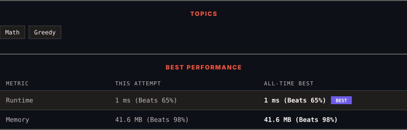

<div align="center">

# 670. Maximum Swap

      

[](https://leetcode.com/problems/maximum-swap/)

</div>

---

<div align="center">

<picture>
  <source media="(prefers-color-scheme: dark)" srcset="panel-dark.svg">
  <source media="(prefers-color-scheme: light)" srcset="panel-light.svg">
  
</picture>

</div>

> **New personal best** — Runtime improved on this submission.

### HOW IT WENT

| | |
|:--|:--|
| **Attempts** | first try |
| **Time to solve** | 1 min |
| **Verdicts** | ✅ Accepted |

---

### NOTES

_No notes yet._

---

### SOLUTIONS (1)

| # | File | Language | Date |
|:-:|------|:--------:|:----:|
| 1 | [sol1.java](./sol1.java) | `Java` | 2026-10-23 ← **latest** |

---

### PROBLEM DESCRIPTION

You are given an integer `num`. You can swap two digits at most once to get the maximum valued number.

Return *the maximum valued number you can get*.

 

**Example 1:**

```

**Input:** num = 2736
**Output:** 7236
**Explanation:** Swap the number 2 and the number 7.

```

**Example 2:**

```

**Input:** num = 9973
**Output:** 9973
**Explanation:** No swap.

```

 

**Constraints:**

	- `0 <= num <= 10^8`

---

<div align="center">

<sub>Auto-synced by <strong>LeetSync</strong> · Built by <a href="https://deveshsamant.in/">Devesh Samant</a></sub>

</div>
