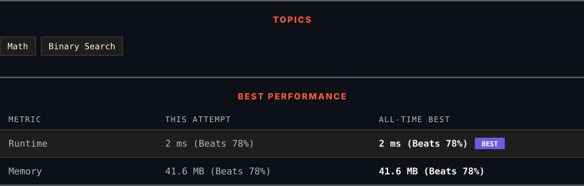

<div align="center">

# 754. Reach a Number

      

[](https://leetcode.com/problems/reach-a-number/)

</div>

---

<div align="center">

<picture>
  <source media="(prefers-color-scheme: dark)" srcset="panel-dark.svg">
  <source media="(prefers-color-scheme: light)" srcset="panel-light.svg">
  
</picture>

</div>

> **New personal best** — Runtime improved on this submission.

### HOW IT WENT

| | |
|:--|:--|
| **Attempts** | first try |
| **Time to solve** | under a minute |
| **Verdicts** | ✅ Accepted |

---

### NOTES

_No notes yet._

---

### SOLUTIONS (1)

| # | File | Language | Date |
|:-:|------|:--------:|:----:|
| 1 | [sol1.java](./sol1.java) | `Java` | 2026-11-15 ← **latest** |

---

### PROBLEM DESCRIPTION

You are standing at position `0` on an infinite number line. There is a destination at position `target`.

You can make some number of moves `numMoves` so that:

	- On each move, you can either go left or right.

	- During the `i^th` move (starting from `i == 1` to `i == numMoves`), you take `i` steps in the chosen direction.

Given the integer `target`, return *the **minimum** number of moves required (i.e., the minimum *`numMoves`*) to reach the destination*.

 

**Example 1:**

```

**Input:** target = 2
**Output:** 3
**Explanation:**
On the 1^st move, we step from 0 to 1 (1 step).
On the 2^nd move, we step from 1 to -1 (2 steps).
On the 3^rd move, we step from -1 to 2 (3 steps).

```

**Example 2:**

```

**Input:** target = 3
**Output:** 2
**Explanation:**
On the 1^st move, we step from 0 to 1 (1 step).
On the 2^nd move, we step from 1 to 3 (2 steps).

```

 

**Constraints:**

	- `-10^9 <= target <= 10^9`

	- `target != 0`

---

<div align="center">

<sub>Auto-synced by <strong>LeetSync</strong> · Built by <a href="https://deveshsamant.in/">Devesh Samant</a></sub>

</div>
