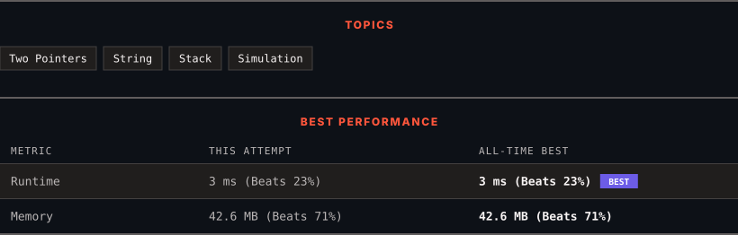

<div align="center">

# 844. Backspace String Compare

      

[](https://leetcode.com/problems/backspace-string-compare/)

</div>

---

<div align="center">

<picture>
  <source media="(prefers-color-scheme: dark)" srcset="panel-dark.svg">
  <source media="(prefers-color-scheme: light)" srcset="panel-light.svg">
  
</picture>

</div>

> **New personal best** — Runtime improved on this submission.

### HOW IT WENT

| | |
|:--|:--|
| **Attempts** | first try |
| **Time to solve** | 16 min |
| **Verdicts** | ✅ Accepted |

---

### NOTES

_No notes yet._

---

### SOLUTIONS (1)

| # | File | Language | Date |
|:-:|------|:--------:|:----:|
| 1 | [sol1.java](./sol1.java) | `Java` | 2026-11-18 ← **latest** |

---

### PROBLEM DESCRIPTION

Given two strings `s` and `t`, return `true` *if they are equal when both are typed into empty text editors*. `'#'` means a backspace character.

Note that after backspacing an empty text, the text will continue empty.

 

**Example 1:**

```

**Input:** s = "ab#c", t = "ad#c"
**Output:** true
**Explanation:** Both s and t become "ac".

```

**Example 2:**

```

**Input:** s = "ab##", t = "c#d#"
**Output:** true
**Explanation:** Both s and t become "".

```

**Example 3:**

```

**Input:** s = "a#c", t = "b"
**Output:** false
**Explanation:** s becomes "c" while t becomes "b".

```

 

**Constraints:**

	- `1 <= s.length, t.length <= 200`

	- `s` and `t` only contain lowercase letters and `'#'` characters.

 

**Follow up:** Can you solve it in `O(n)` time and `O(1)` space?

---

<div align="center">

<sub>Auto-synced by <strong>LeetSync</strong> · Built by <a href="https://deveshsamant.in/">Devesh Samant</a></sub>

</div>
