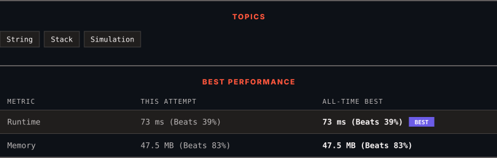

<div align="center">

# 2390. Removing Stars From a String

      

[](https://leetcode.com/problems/removing-stars-from-a-string/)

</div>

---

<div align="center">

<picture>
  <source media="(prefers-color-scheme: dark)" srcset="panel-dark.svg">
  <source media="(prefers-color-scheme: light)" srcset="panel-light.svg">
  
</picture>

</div>

> **New personal best** — Runtime improved on this submission.

### HOW IT WENT

| | |
|:--|:--|
| **Attempts** | first try |
| **Time to solve** | 12 min |
| **Verdicts** | ✅ Accepted |

---

### NOTES

_No notes yet._

---

### SOLUTIONS (1)

| # | File | Language | Date |
|:-:|------|:--------:|:----:|
| 1 | [sol1.java](./sol1.java) | `Java` | 2026-11-18 ← **latest** |

---

### PROBLEM DESCRIPTION

You are given a string `s`, which contains stars `*`.

In one operation, you can:

	- Choose a star in `s`.

	- Remove the closest **non-star** character to its **left**, as well as remove the star itself.

Return *the string after **all** stars have been removed*.

**Note:**

	- The input will be generated such that the operation is always possible.

	- It can be shown that the resulting string will always be unique.

 

**Example 1:**

```

**Input:** s = "leet**cod*e"
**Output:** "lecoe"
**Explanation:** Performing the removals from left to right:
- The closest character to the 1^st star is 't' in "lee**t****cod*e". s becomes "lee*cod*e".
- The closest character to the 2^nd star is 'e' in "le**e***cod*e". s becomes "lecod*e".
- The closest character to the 3^rd star is 'd' in "leco**d***e". s becomes "lecoe".
There are no more stars, so we return "lecoe".
```

**Example 2:**

```

**Input:** s = "erase*****"
**Output:** ""
**Explanation:** The entire string is removed, so we return an empty string.

```

 

**Constraints:**

	- `1 <= s.length <= 10^5`

	- `s` consists of lowercase English letters and stars `*`.

	- The operation above can be performed on `s`.

---

<div align="center">

<sub>Auto-synced by <strong>LeetSync</strong> · Built by <a href="https://deveshsamant.in/">Devesh Samant</a></sub>

</div>
